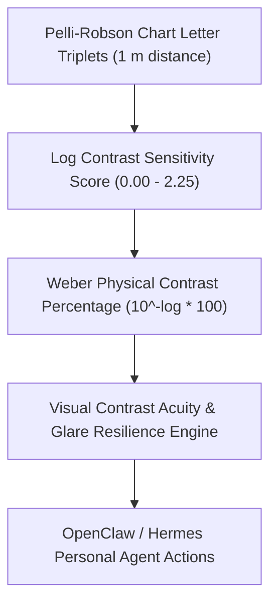

# Visual Contrast Sensitivity (Pelli-Robson) Skill

[](LICENSE)
[](https://www.python.org/)
[](requirements.txt)
[](mcp_server.py)
[](SKILL.md)

Zero-dependency sovereign personal agent skill for non-invasive evaluation of Visual Contrast Sensitivity Function (CSF), Pelli-Robson chart log scores, and digital display ergonomics.



## Features
- **Deterministic Math**: Pure Python standard library implementation with zero external dependencies.
- **Clinical Psychophysical Standards**: Implements validated logarithmic Pelli-Robson formulas.
- **Display Readability & Glare Stratification**: Direct quantification of visual edge sharpness under digital screen work.
- **Model Context Protocol (MCP)**: Native JSON-RPC tool integration for LLMs and autonomous agents.

## Quickstart

```python
from client import OcularContrastSensitivityClient

client = OcularContrastSensitivityClient()
result = client.evaluate_contrast_sensitivity(
    log_contrast_score=1.80
)
print("Weber Contrast Threshold:", result["weber_contrast_threshold_pct"], "%")
print("Classification:", result["classification"])
```

## License
Apache-2.0
